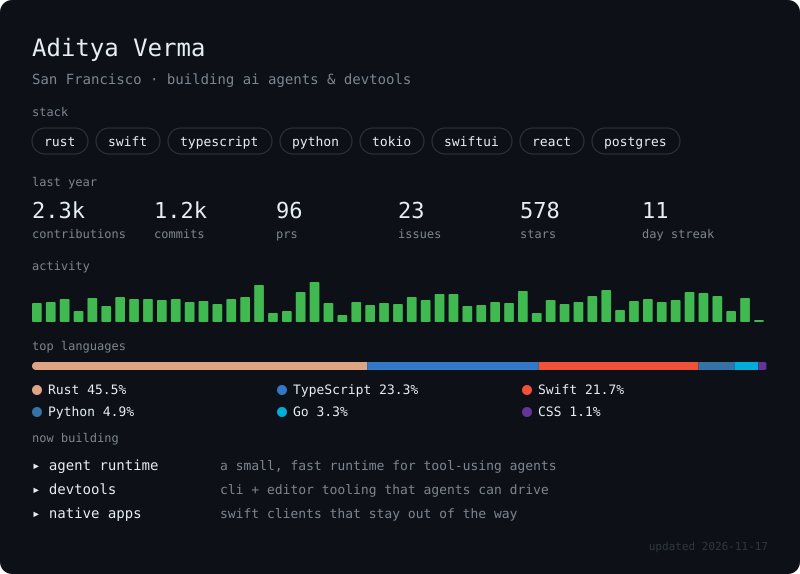

<p align="center">
  
</p>

<p align="center">
  rust · swift · typescript — agents, devtools, and the native apps around them
</p>

---

<details>
<summary>how this card is made</summary>

`assets/readme.svg` is rendered by [`scripts/gen_svg.py`](scripts/gen_svg.py) from
[`profile.toml`](profile.toml) plus live data from the GitHub GraphQL API.
The [update readme](.github/workflows/update-readme.yml) workflow re-renders it every day
and commits the result.

```sh
make offline   # render with data/sample_user.json, no token needed
GITHUB_TOKEN=... make svg   # render with live stats
make test
```

Stdlib only, Python 3.11+.

</details>
